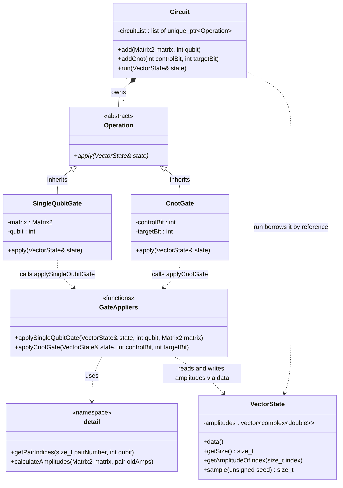

# Architecture

## Decisions: 

In order to implement our GPU Backend we need to adjust some of our architecture.

In order to avoid long data copying we will only copy the vector state once from the host to the device. This will happen at the beginning of our `circuit.run()`. We manipulate the state on the device and only copy the state back once we have completed the computations. 

We do not have to change much of our current architecture, but since we initialize the device pointer in our circuit we will have to pass it down through our functions, so our kernel can manipulate our data.
